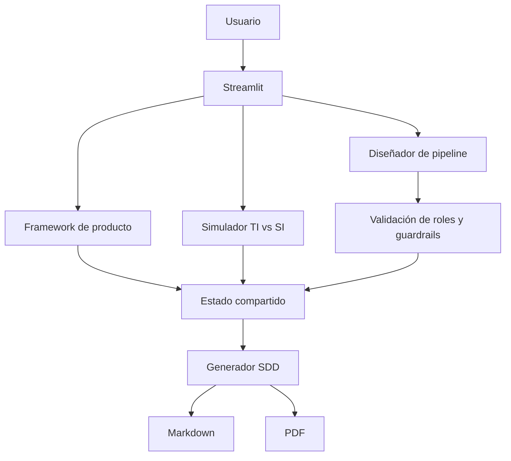

# AI Product Ops — Diseño y gobernanza de sistemas de IA

Prototipo interactivo en Streamlit para convertir una idea de producto basada en IA en una especificación operable: arquitectura funcional, economía unitaria, responsables, métricas, guardrails y controles de gobernanza.

> **Estado:** prototipo académico/portfolio. No conecta con modelos externos ni despliega infraestructura productiva.

## Problema que aborda

Un caso de uso de IA puede parecer viable por la calidad de sus respuestas y, aun así, fracasar por costes, latencia, falta de responsables, exposición de datos o ausencia de mecanismos de intervención. Esta herramienta reúne esas dimensiones en un flujo de diseño revisable.

## Capacidades

- Framework de producto: People, Process, Data, Technology y Policy.
- Simulador de coste de inferencia frente al coste de intervención humana.
- Diseño y ordenación de un pipeline de componentes.
- Asignación de responsables operativos, de seguridad y de datos.
- Definición de métricas de resultado, eficiencia y seguridad.
- Guardrails para latencia y tasa máxima de alucinación.
- Generación de una especificación de diseño (SDD) en Markdown y PDF.
- Checklist de preparación para detectar controles y responsabilidades pendientes.

## Arquitectura de la aplicación



El estado de la sesión se centraliza en `app.py`; las páginas se encargan de cada área funcional y `utils/` concentra lógica reutilizable.

## Ejecución local

```bash
python -m venv .venv
# Windows
.venv\Scripts\activate
# macOS/Linux
source .venv/bin/activate
pip install -r requirements.txt
streamlit run app.py
```

## Pruebas

```bash
python -m unittest discover -s tests -v
```

La integración continua instala dependencias, compila los módulos Python y ejecuta las pruebas unitarias.

## Supuestos económicos

El simulador estima el coste de tokens y el coste humano de los tickets que la IA no resuelve, suponiendo que cada uno consume el AHT completo. El coste total mostrado es **parcial**: no incluye configuración, licencias, mantenimiento, supervisión, evaluación, observabilidad ni otros costes indirectos. No debe interpretarse como un business case definitivo.

## Controles y limitaciones

- El pipeline requiere componentes válidos, posiciones únicas y orden consecutivo.
- El SDD requiere responsables mínimos, métricas, pipeline y umbrales válidos.
- La checklist verifica los responsables individualmente.
- Los valores económicos dependen de los parámetros y supuestos introducidos.
- No existe conexión real con un proveedor de modelos, CRM, ticketing ni infraestructura cloud.
- Antes de producción habría que incorporar autenticación real, autorización por rol, gestión de secretos, trazabilidad persistente, evaluación del modelo, pruebas de carga y revisión de privacidad.

## Estructura

| Ruta | Responsabilidad |
|---|---|
| `app.py` | Estado común y navegación |
| `pages/` | Framework, simulador, diseñador y auditoría |
| `utils/economics.py` | Cálculos económicos y validación |
| `utils/reporting.py` | Checklist y generación de SDD/PDF |
| `tests/` | Pruebas unitarias |

## Demostración sugerida

1. Revisar el framework y definir el caso de uso.
2. Introducir volumen, costes y tiempos en el simulador.
3. Diseñar el pipeline y comprobar su orden.
4. Asignar responsables y definir métricas y guardrails.
5. Revisar la checklist y exportar el SDD.

## Privacidad

No introduzcas datos personales reales, credenciales ni información confidencial. El proyecto es una herramienta de diseño y aprendizaje, no un sistema certificado para tomar decisiones de producción.
